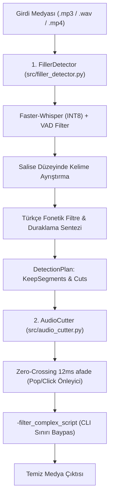

# 🏛️ AudioCleaner Mimarisi

Bu belge, AudioCleaner'ın modüler yapısını, veri akışını ve akustik kurgu standartlarını açıklar.

---

## 1. Katmanlı Mimari ve Sorumluluklar (SRP)

---

## 2. Değişmez Mimari Kurallar

1. **Zero-Crossing Micro-Fade:** Ham sert kesim (`hard cut`) dalga formunda DC adımı oluşturarak hoparlör patlamasına (audio pop/click) neden olur. Tüm kesim kenarlarına üçgen eğrili 12-15ms `afade` zorunludur.
2. **Doğal Nefes Payı (Breath Retention):** Sözcükler arasındaki tüm boşlukları kesmek robotik bir his verir. 0.45s üzerindeki duraklamalarda kelimelerin arasında en az 0.20s doğal boşluk bırakılır.
3. **Windows CLI Limit Koruması:** Onlarca kesim yapıldığında FFmpeg argümanları Windows 8192 karakter sınırını aşabilir. Kurgu grafı daima geçici `-filter_complex_script` üzerinden verilir.
4. **Video-Audio Senkron Kilidi:** Video dosyalarında video trim (`trim`) ve ses trim (`atrim`) aynı zaman damgalarıyla eşzamanlı işletilir; video ve ses dudak senkronu (lip-sync) korunur.
5. **Zero-Bloat İlkesi:** Harici ağır SaaS API'ları yerine yerel INT8 Faster-Whisper ve sistem FFmpeg ikilisi kullanılır.
